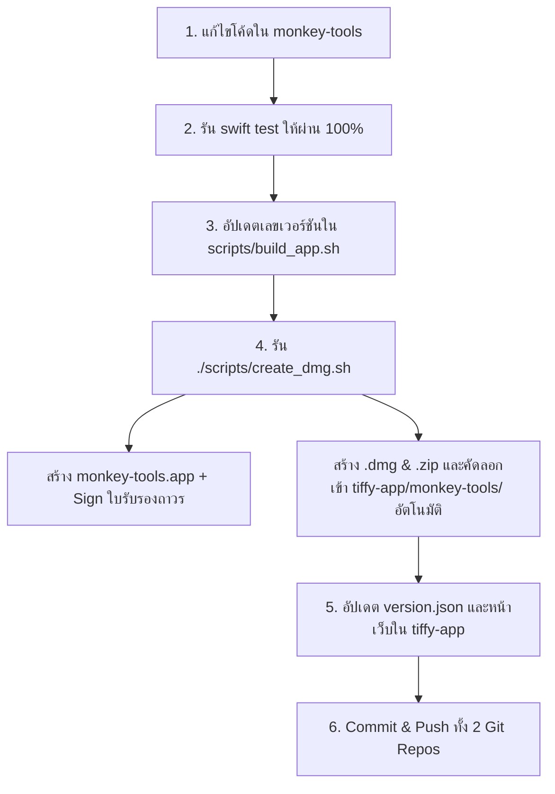

# 🚀 คู่มือขั้นตอนการพัฒนาและปล่อยอัปเดต `monkey-tools` (Dev & Release Workflow)

เอกสารนี้สรุปขั้นตอนตั้งแต่การเขียนโค้ด ทดสอบ บิลด์แพ็กเกจ ไปจนถึงการปล่อยอัปเดตขึ้นสู่ `tiffy-app` (GitHub Pages) เพื่อให้ทั้งการดาวน์โหลดหน้าเว็บและระบบ In-App Auto-Updater ทำงานเชื่อมกันครบวงจร

---

## 🗺️ แผนผังการไหลของข้อมูล (Release Pipeline)



---

## 🛠️ ขั้นตอนที่ 1: พัฒนาและทดสอบในเครื่อง (Local Development)

ทำงานที่โฟลเดอร์ `/Users/pakkawat/Documents/my-tools/monkey-tools`

1. **แก้ไขโค้ด** ใน `Sources/MonkeyTools/` และเพิ่ม/แก้ไขเทสต์ใน `Tests/MonkeyToolsTests/`
2. **รัน Unit Tests ทั้งหมด** (ต้องผ่าน 0 failures ก่อนเสมอ):
   ```bash
   cd /Users/pakkawat/Documents/my-tools/monkey-tools
   swift test
   ```
3. **ทดสอบ Build และติดตั้งลงเครื่อง (`/Applications/monkey-tools.app`):**
   ```bash
   ./scripts/build_app.sh
   open /Applications/monkey-tools.app
   ```
   > **หมายเหตุสำคัญ:** สคริปต์ `build_app.sh` จะใช้ใบรับรอง `MonkeyToolsDeveloper` ใน Keychain เพื่อรักษาสิทธิ์ Accessibility ไม่ให้หลุดเวลาบิลด์ใหม่

---

## 📦 ขั้นตอนที่ 2: ปรับเลขเวอร์ชันและสร้างไฟล์ติดตั้ง (Bump Version & Package)

เมื่อพร้อมปล่อยเวอร์ชันใหม่ (เช่น `2.1.7` -> `2.1.8`):

1. **อัปเดตเลขเวอร์ชันใน [`scripts/build_app.sh`](file:///Users/pakkawat/Documents/my-tools/monkey-tools/scripts/build_app.sh):**
   แก้ค่า `CFBundleShortVersionString` และ `CFBundleVersion` ให้เป็นเวอร์ชันใหม่:
   ```xml
   <key>CFBundleShortVersionString</key>
   <string>2.1.8</string>
   <key>CFBundleVersion</key>
   <string>2.1.8</string>
   ```

2. **รันสคริปต์สร้างแพ็กเกจ (`create_dmg.sh`):**
   ```bash
   cd /Users/pakkawat/Documents/my-tools/monkey-tools
   ./scripts/create_dmg.sh
   ```
   **สิ่งที่สคริปต์นี้ทำให้โดยอัตโนมัติ:**
   - เรียก `./scripts/build_app.sh` เพื่อคอมไพล์ Release binary และอัปเดต `/Applications/monkey-tools.app`
   - สร้างไฟล์ `monkey-tools-Installer.dmg` (สำหรับคนดาวน์โหลดไปติดตั้งครั้งแรก)
   - สร้างไฟล์ `monkey-tools.zip` (สำหรับระบบ **In-App Auto-Updater** ดึงไปแตกไฟล์ทับอัตโนมัติ)
   - คัดลอกทั้ง `.dmg` และ `.zip` ไปวางที่:
     - `monkey-tools/docs/`
     - `tiffy-app/monkey-tools/`

---

## 🌐 ขั้นตอนที่ 3: อัปเดต Manifest และหน้าเว็บใน `tiffy-app`

ทำงานที่โฟลเดอร์ `/Users/pakkawat/Documents/my-tools/tiffy-app`

1. **อัปเดตไฟล์ [`monkey-tools/version.json`](file:///Users/pakkawat/Documents/my-tools/tiffy-app/monkey-tools/version.json) (สำคัญที่สุดสำหรับ Auto-Updater):**
   แก้ไข `latestVersion`, `releaseDate`, และ `releaseNotes`:
   ```json
   {
     "latestVersion": "2.1.8",
     "releaseDate": "YYYY-MM-DD",
     "downloadUrl": "https://pakkawatkh.github.io/tiffy-app/monkey-tools/monkey-tools-Installer.dmg",
     "zipUrl": "https://pakkawatkh.github.io/tiffy-app/monkey-tools/monkey-tools.zip",
     "pageUrl": "https://pakkawatkh.github.io/tiffy-app/monkey-tools/",
     "releaseNotes": "สรุปฟีเจอร์ใหม่หรือสิ่งที่แก้ไขในเวอร์ชันนี้"
   }
   ```

2. **อัปเดตเลขเวอร์ชันและฟีเจอร์บนหน้าเว็บไซต์:**
   - **หน้า Landing Page ของแอป (`tiffy-app/monkey-tools/index.html`):**
     - อัปเดต `"softwareVersion"` ใน Schema.org JSON-LD
     - อัปเดตป้ายประกาศ Hero Badge (`What's New in v2.1.8...`) และรายละเอียดฟีเจอร์หากมีการเพิ่มความสามารถใหม่
   - **หน้ารวมแอป Tiffy Portal (`tiffy-app/index.html`):**
     - อัปเดตป้าย `● Released v2.1.8` ในการ์ดของ Monkey Tools

---

## 🚢 ขั้นตอนที่ 4: Commit & Deploy ขึ้น GitHub (ทั้ง 2 Repositories)

เนื่องจากแยก Git Repo กัน ต้องสั่ง Commit และ Push ทั้งที่ `monkey-tools` และ `tiffy-app`:

### 4.1 Push ซอร์สโค้ดขึ้น Repo `monkey-tools`
```bash
cd /Users/pakkawat/Documents/my-tools/monkey-tools
git status
git add -A
git commit -m "feat(v2.1.8): คำอธิบายสิ่งที่พัฒนาเพิ่ม"
git push origin main
```

### 4.2 Push ไฟล์ติดตั้งและหน้าเว็บขึ้น Repo `tiffy-app` (Deploy สู่ GitHub Pages)
```bash
cd /Users/pakkawat/Documents/my-tools/tiffy-app
git status
git add -A
git commit -m "release(monkey-tools): publish v2.1.8 package, manifest, and website updates"
git push origin main
```

---

## ✅ ขั้นตอนที่ 5: ตรวจสอบหลัง Deploy (Post-Deploy Check)

หลังจาก Push ขึ้น `tiffy-app` ประมาณ 1–2 นาที GitHub Pages จะอัปเดตอัตโนมัติ:
- **เช็ก Manifest อัปเดต:** เปิด `https://pakkawatkh.github.io/tiffy-app/monkey-tools/version.json` ดูว่าเลข `latestVersion` เปลี่ยนเป็นเวอร์ชันใหม่แล้ว
- **เช็กหน้าเว็บ:** เปิด `https://pakkawatkh.github.io/tiffy-app/` และ `https://pakkawatkh.github.io/tiffy-app/monkey-tools/`
- **เช็กในตัวแอป:** เปิดแอป `monkey-tools` -> `Settings` -> แท็บ `ทั่วไป (General)` -> กดปุ่ม **"ตรวจสอบการอัปเดต (Check for Updates)"**
